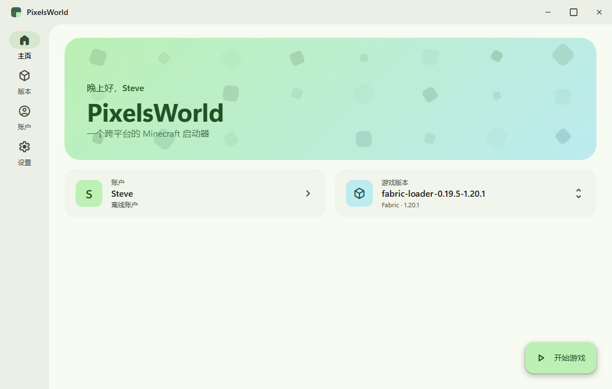
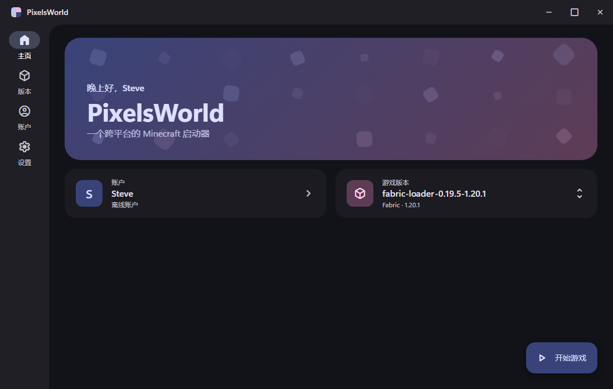
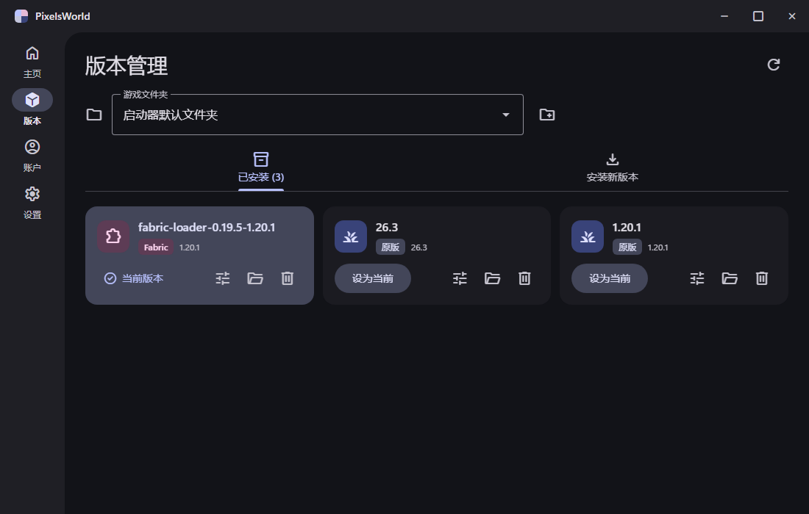

<div align="center">

# PixelsWorld Launcher

**一个跨平台、Material Design 3 风格的 Minecraft: Java Edition 启动器**

[](https://github.com/zhuzhi-09/PixelsWorldLauncher/releases)
[](https://github.com/zhuzhi-09/PixelsWorldLauncher/actions)
[](LICENSE)




</div>

## 简介

PixelsWorld 是一个开源的 Minecraft 启动器，界面完全遵循 Google 的 Material Design 3（Material You）设计语言，基于 Electron 运行在 Windows、macOS 与 Linux 上。选一个主题色，整套界面配色会自动生成；浅色、深色模式随系统切换。

它也能和 [PCL-CE](https://github.com/PCL-Community/PCL-CE) 共用同一个 `.minecraft`：版本独立设置互通，还能一键导入 PCL-CE 的设置、游戏文件夹和账户。

<table>
  <tr>
    <td></td>
    <td></td>
  </tr>
  <tr>
    <td align="center">深色模式 · 自定义主题色</td>
    <td align="center">版本管理</td>
  </tr>
</table>

## 功能

- **安装**：原版（正式版 / 预览版 / 远古版 / 愚人节版），以及 Fabric、Quilt、Legacy Fabric、LiteLoader，可自定义版本名称；缺失文件在启动前自动补全
- **社区资源**：从 Modrinth 搜索并安装模组、数据包、资源包、光影，按游戏版本与加载器筛选兼容文件，自动安装前置模组；支持收藏夹
- **启动**：支持新旧两种参数格式与 `inheritsFrom` 继承；实时查看游戏日志（log4j XML 日志转为可读文本）
- **Java**：自动检测本机 Java，没有合适版本时自动下载 Mojang 官方 Java 运行时
- **账户**：离线账户、微软账户（设备代码登录，令牌由系统钥匙串加密保存）
- **下载**：官方源 / BMCLAPI 镜像，镜像失败时自动回退
- **多游戏文件夹**：自动识别启动器旁的 `.minecraft` 与官方启动器文件夹，也可手动添加
- **版本设置**：版本隔离、内存、Java、JVM / 游戏参数、自动进服、启动前命令等，可按版本单独设置
- **外观**：Material You 动态配色、浅色 / 深色模式

### 与 PCL-CE 兼容

- 版本独立设置直接读写 `versions/<版本>/PCL/config.v1.yml`（兼容旧版 `setup.ini`），两个启动器互相切换不丢设置
- 版本隔离策略、内存刻度与 PCL-CE 一致；在 `PCL.ini` 中记住每个文件夹选择的版本
- 从 PCL-CE 导入全局设置、游戏文件夹和账户（Windows 上通过 DPAPI 解密账户档案）

## 下载

在 [Releases](https://github.com/zhuzhi-09/PixelsWorldLauncher/releases) 页面下载对应平台的安装包：

| 平台 | 文件 |
| --- | --- |
| Windows | `*-setup.exe`（安装版）、`*-portable.exe`（便携版） |
| macOS | `*.dmg`（Intel 与 Apple Silicon） |
| Linux | `*.AppImage`、`*.deb` |

> 安装包暂未签名。Windows 若提示「Windows 已保护你的电脑」，点「更多信息 → 仍要运行」；macOS 首次打开请右键选择「打开」。

## 开发

技术栈：Electron + Vue 3 + TypeScript + [@material/web](https://github.com/material-components/material-web)，配色由 [material-color-utilities](https://github.com/material-foundation/material-color-utilities) 生成。

```bash
npm install
npx install-electron   # 首次需要下载 Electron 二进制
npm run dev            # 开发模式（热更新）
npm run typecheck      # 类型检查
npm run dist           # 打包当前平台的安装包到 dist/
```

推送 `v*` 标签会触发 GitHub Actions，在三个平台上打包并发布到 Releases：

```bash
git tag v0.1.0
git push origin v0.1.0
```

> **项目放在网络驱动器上时**：Electron 的沙箱进程无法读取网络共享上的 `node_modules/electron/dist`，会直接崩溃。
> 把该目录复制到本地磁盘，再用 `ELECTRON_EXEC_PATH` 指向其中的可执行文件即可：
>
> ```powershell
> Copy-Item -Recurse node_modules\electron\dist $env:LOCALAPPDATA\electron-dist
> $env:ELECTRON_EXEC_PATH = "$env:LOCALAPPDATA\electron-dist\electron.exe"; npm run dev
> ```

### 微软登录

正版登录需要你自己的 Azure 应用：

1. 在 [Azure 门户](https://portal.azure.com/#view/Microsoft_AAD_RegisteredApps/ApplicationsListBlade) 注册应用，账户类型选「仅个人 Microsoft 账户」
2. 在「身份验证」中开启「允许公共客户端流」
3. 通过 [Mojang 的申请表](https://aka.ms/mce-reviewappid) 申请 Minecraft API 访问权限（审核通过前 `login_with_xbox` 会返回 403）
4. 把 Client ID 填到启动器的「设置 → 微软登录」

### 目录结构

```
src/
  main/              主进程
    core/
      config.ts      配置读写
      download.ts    并发下载、镜像、sha1 校验
      version.ts     版本 JSON 解析、规则判断、库文件解析
      install.ts     原版安装与文件补全
      loaders.ts     Fabric / Quilt / Legacy Fabric / LiteLoader 安装
      modrinth.ts    Modrinth 资源搜索、安装与收藏夹
      instance.ts    版本分类、加载器识别、版本隔离
      folders.ts     游戏文件夹识别与切换
      memory.ts      内存分配
      java.ts        Java 检测与官方运行时下载
      accounts.ts    离线 / 微软账户
      launch.ts      组装启动参数、启动进程、日志解析
      pcl/           PCL-CE 配置读写、导入与解密
  preload/           暴露给渲染进程的安全 API
  renderer/          Vue 界面（MD3）
  shared/            主进程与界面共享的类型与工具
```

## 后续计划

- Forge / NeoForge / Cleanroom、OptiFine 安装
- Modrinth 整合包安装
- CurseForge 资源与世界下载、LabyMod
- 应用图标、自动更新

## 许可与致谢

本项目基于 [Apache License 2.0](LICENSE) 开源。

PCL-CE 兼容功能参考了 [PCL-CE](https://github.com/PCL-Community/PCL-CE) 中 PCL.Core 部分（Apache-2.0）定义的配置与加密格式，详见 [NOTICE](NOTICE)。本项目与 PCL / PCL-CE 项目无关，不包含 PCL-CE 中按地区限制功能的逻辑。

Minecraft 是 Mojang Synergies AB 的商标。本项目不是 Minecraft 官方产品，与 Mojang 或 Microsoft 无关。
